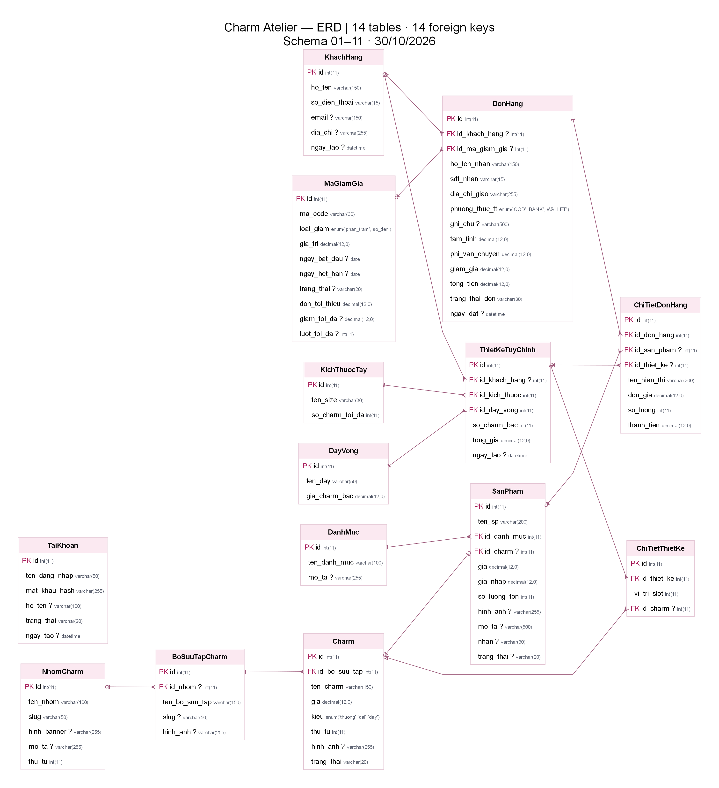

# ERD Charm Atelier

Sơ đồ đối chiếu với metadata của DB kiểm thử sau khi import schema repo 01–16 ngày 30/10/2026, bản main `899ea7f`: **14 bảng, 14 khóa ngoại**. Đây là schema repo trong MySQL tạm độc lập, không phải bản chụp DB starter local. SQL 12–16 chỉ thay đổi dữ liệu, không thêm bảng/cột/khóa ngoại so với bản SQL 11.

`PK`: khóa chính; `FK`: khóa ngoại; `?`: cột cho phép NULL. Chân quạ: phía nhiều; vòng tròn ở phía cha: quan hệ tùy chọn. `TaiKhoan` quản trị độc lập nên không có đường nối.

Các ký hiệu vòng tròn, vạch và chân quạ đã được phóng lớn, tăng độ đậm và nối liền với đường quan hệ để nhìn rõ khi xem/in. Ý nghĩa quan hệ và dữ liệu schema giữ nguyên.

## Bố cục ảnh

Đã bỏ tiêu đề lớn phía trên. Mỗi bảng có ba cột **KEY / ATTRIBUTE / DATA TYPE**, đường kẻ từng dòng và chữ tối để đọc rõ khi in. Các bảng được đặt cố định theo nhóm, đường nối vuông góc không cắt nhau và không đi xuyên nội dung bảng. Phía bảng con, đường nối kết thúc ở dòng cột FK tương ứng; phía bảng cha, tham chiếu khóa chính `id` như danh sách bên dưới.

- Đầu bảng hồng: danh mục, sản phẩm và dữ liệu charm.
- Đầu bảng xanh dương: dây vòng, kích thước và thiết kế tùy chỉnh.
- Đầu bảng xanh lá: khách hàng, mã giảm giá và đơn hàng.
- Đầu bảng xám: `TaiKhoan`, dùng riêng cho đăng nhập quản trị. Bảng này không có khóa ngoại và không được bảng nào khác tham chiếu trong schema hiện tại; vẫn giữ trong ERD để đủ 14 bảng.

## Cập nhật MaGiamGia theo migration 11

| Cột mới | Kiểu dữ liệu | Cho phép NULL | Mặc định |
|---|---|---|---|
| `don_toi_thieu` | `DECIMAL(12,0)` | Không | `0` |
| `giam_toi_da` | `DECIMAL(12,0)` | Có | `NULL` |
| `luot_toi_da` | `INT` | Có | `NULL` |

Cả ba cột đã có trong PNG, SVG và nguồn DOT. Migration 10 chỉ thêm chỉ mục; migration 11 thêm thuộc tính, không thêm bảng hay khóa ngoại. Quan hệ `DonHang.id_ma_giam_gia → MaGiamGia.id` giữ nguyên.

## Các khóa ngoại

| Bảng con | Cột FK | Tham chiếu |
|---|---|---|
| BoSuuTapCharm | id_nhom | NhomCharm.id |
| Charm | id_bo_suu_tap | BoSuuTapCharm.id |
| ChiTietDonHang | id_don_hang | DonHang.id |
| ChiTietDonHang | id_san_pham | SanPham.id |
| ChiTietDonHang | id_thiet_ke | ThietKeTuyChinh.id |
| ChiTietThietKe | id_thiet_ke | ThietKeTuyChinh.id |
| ChiTietThietKe | id_charm | Charm.id |
| DonHang | id_khach_hang | KhachHang.id |
| DonHang | id_ma_giam_gia | MaGiamGia.id |
| SanPham | id_charm | Charm.id |
| SanPham | id_danh_muc | DanhMuc.id |
| ThietKeTuyChinh | id_khach_hang | KhachHang.id |
| ThietKeTuyChinh | id_kich_thuoc | KichThuocTay.id |
| ThietKeTuyChinh | id_day_vong | DayVong.id |

Nguồn có thể sửa: [erd.dot](erd.dot). Bản vector để chèn báo cáo và phóng to: [erd.svg](erd.svg), [erd.pdf](erd.pdf). PNG được xuất ở 300 DPI; nên dùng SVG trong Word hoặc PDF khi xem/in để giữ chữ sắc nét. Nguồn DOT chứa tọa độ cố định của bảng và đường nối. Xuất lại bằng Graphviz để giữ bố cục: `neato -n2 -Tpng -Gdpi=300 erd.dot -o erd.png`, `neato -n2 -Tsvg erd.dot -o erd.svg` và `neato -n2 -Tpdf erd.dot -o erd.pdf`.
